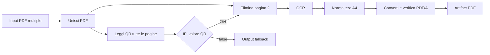

# Collaudo integrato

Il collaudo combina test automatici locali e una prova HTTP reale. I test automatici non sostituiscono Neon, Cubbit o il worker: la prova E2E richiede tutte e tre le componenti operative.

## Workflow di riferimento

`worker/tests/fixtures/integration_pipeline.graph.json` è il grafo importabile nell'editor. Il test TypeScript lo valida con le stesse funzioni di validazione e compilazione usate dalla pubblicazione. L'ordine è:



Il primo PDF è una pagina A3 raster con testo da riconoscere. Il secondo è una pagina A4 che contiene un QR con valore `PIPELINE-QR-TEST`; il ramo vero la elimina. L'output principale deve quindi contenere una pagina A4 portrait con testo OCR selezionabile e verifica veraPDF completata. Il ramo fallback non deve produrre un artifact.

Genera le fixture con:

```powershell
cd worker
pip install -r test-requirements.txt
python tests\generate_fixtures.py
```

Il generatore crea `pipeline-scan-page.pdf`, `pipeline-qr-page.pdf`, `pipeline-corrupt.pdf` e fixture generali per formati misti, barcode, testo e segnalibri. I PDF sono dati di test, non dati di produzione.

## Test automatici

```powershell
npm test
npm run typecheck
npm run lint
npm run test:worker
```

Le suite includono round-trip del grafo e viewport, reconnect/cancellazione edge, controllo DAG, compilazione deterministica, diagnostica, pubblicazione con revision/hash, API schema, firma HMAC, anti-replay e limiti dei loop. I test CRUD che usano PostgreSQL sono saltati se `WORKFLOW_TEST_DATABASE_URL` non punta a un database dedicato riconoscibile come test. I test worker verificano gli handler PDF e rami, retry, timeout, cancellazione e recovery. Il test OCR worker viene saltato con un motivo esplicito se Tesseract o Poppler mancano.

## Prova HTTP reale

La prova crea un batch univoco nel tenant dedicato, salva il draft tramite API, lo rilegge, lo pubblica, crea una chiave con scope per quel batch, carica i PDF direttamente su Cubbit, invia richieste HMAC, controlla idempotenza concorrente e stato asincrono, scarica e parse il PDF risultante. Al termine revoca la chiave e archivia il batch. Le righe job, eventi e artifact restano soggette alla retention configurata.

Avviare Next.js con variabili locali, applicare le migrazioni approvate, avviare il worker e verificare che il worker disponga di:

- Poppler (`pdftoppm`) e Tesseract con lingua `eng`;
- zxing-cpp per il decoder QR;
- Ghostscript, veraPDF CLI e un profilo ICC RGB valido per il target PDF/A-2b;
- credenziali Cubbit separate con accesso agli input e agli output del test.

Il worker deve comunicare con l'API interna autenticata. Non avviare questa prova contro Production: crea job, carica documenti e scrive nello storage.

PowerShell:

```powershell
$env:PDFORCH_E2E_BASE_URL = "http://localhost:3000"
$env:PDFORCH_E2E_COOKIE = "<cookie sessione Supabase di un amministratore del tenant test>"
$env:PDFORCH_E2E_ORGANIZATION_ID = "<uuid organizzazione dedicata ai test>"
$env:PDFORCH_E2E_TIMEOUT_SECONDS = "1800"
cd worker
python tests\e2e_local.py
```

Opzionalmente, configurare `PDFORCH_E2E_FOREIGN_BATCH_SLUG` e `PDFORCH_E2E_FOREIGN_RUN_ID` per verificare il rifiuto delle risorse di un altro tenant. `PDFORCH_E2E_REVOKED_KEY_ID` e `PDFORCH_E2E_REVOKED_SECRET` aggiungono il controllo di una chiave già revocata. I segreti restano in memoria nel processo e non vengono stampati.

La prova verifica firma errata, riuso del nonce, input JSON incompleto, upload con hash e file verificabili, run duplicate simultanee sotto una sola chiave idempotenza, tutti gli step richiesti, ramo non selezionato, PDF scaricato e parsabile, pagina A4, testo OCR, file corrotto che deve fallire senza artifact e revoca della chiave. Non sostituisce il controllo manuale del rendering su un visualizzatore PDF né una verifica indipendente ulteriore del report veraPDF.

Se i servizi non sono configurati, la prova non va conteggiata come superata: impostare le variabili mancanti e ripeterla. Il comando termina con codice 2 quando mancano credenziali o fixture e con codice 1 quando un'asserzione o un servizio fallisce.

## Checklist deploy

- [ ] Eseguire `npm ci`, `npx prisma validate`, `npx prisma generate`, `npm run typecheck`, `npm run lint`, `npm test`, `npm run test:worker` e `npm run build`.
- [ ] Revisionare le migrazioni additive e applicarle separatamente dal build, dopo backup e approvazione.
- [ ] Impostare su Vercel le variabili server-only e verificare runtime Node.js; non impostare Output Directory personalizzata.
- [ ] Configurare Cubbit bucket, endpoint, chiavi server e worker, retention e policy di accesso.
- [ ] Verificare salute worker, versione del catalogo handler, limiti CPU/RAM/temporanei e restart supervisionato.
- [ ] Pubblicare il grafo fixture in un tenant di test dedicato e verificare il piano compilato prima di avviare E2E.
- [ ] Eseguire la prova HTTP reale solo su Preview/staging con credenziali e bucket dedicati; verificare artifact e log requestId senza secret.
- [ ] Verificare nel database lo stato terminale, gli step, l'evento audit, idempotenza e la revoca/archiviazione eseguite.
- [ ] Non segnare la release come collaudata se Neon, Cubbit, worker o gli strumenti nativi richiesti non erano collegati.
