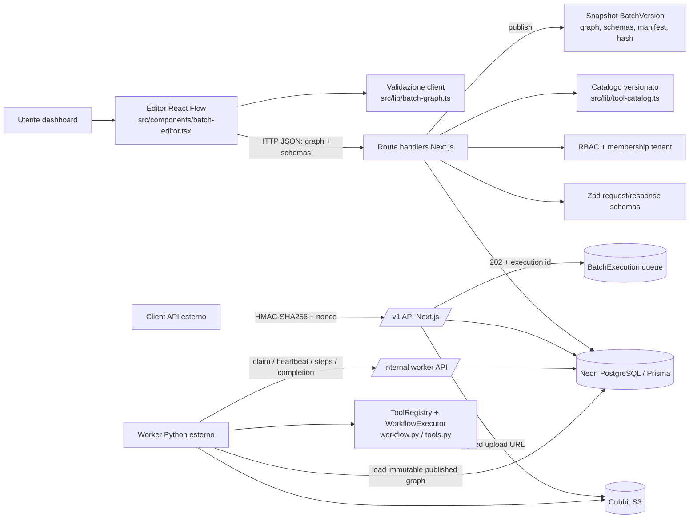

# Architettura dei workflow PDFOrchestrator

## Scopo e stato

Questo documento descrive il flusso effettivo e separa editor, validatore, compiler/catalogo, pubblicazione e runtime. Le lacune residue sono indicate nel backlog.

## Mappa componenti

### Componenti individuati

| Area | Implementazione corrente | Responsabilità |
|---|---|---|
| UI dashboard/editor | `src/app/dashboard/**`, `src/components/batch-editor.tsx` | Modifica grafo, configurazione nodi e parametri API; invia snapshot e schema alle route. |
| Catalogo strumenti | `src/lib/tool-catalog.ts`, `worker/pdforchestrator/tools.py` | Definizioni TypeScript per editor/API gestionali e registry Python per implementazioni eseguibili. La pubblicazione confronta `logicalId` e versione con il catalogo TS. |
| Validatore | `src/lib/batch-graph.ts`, `src/lib/schemas/api.ts`, route `src/app/api/batches/[batchId]/versions/route.ts` | Controlla nodi start/end, raggiungibilità, ingressi/cardinalità, tipi/direzione porte, rami IF, uscite terminali, scope loop e assenza di cicli; restituisce diagnostica con `nodeId`/`edgeId`. La UI mantiene messaggi leggibili e il route restituisce anche diagnostica strutturata. |
| Compiler | `src/lib/blocks/compiler.ts` | Compila solo grafi validi in un piano JSON deterministico formato 2: ordine topologico con tie-break per ID, blocchi/istruzioni tipizzate, porte, handler/runtime/versione, regioni loop e trasferimenti. Include manifest API/variabili/handler, `graphHash` e `planHash`; non genera né esegue codice. |
| Pubblicazione/versioni | API `src/app/api/workflows/[workflowId]/{validate,publish,rollback,versions}/route.ts`; modelli `Workflow`, `WorkflowDraft`, `WorkflowVersion`, `WorkflowPublication` | Valida e ricompila sul server, salva il piano/hash nella revisione draft, pubblica atomicamente uno snapshot immutabile e consente rollback puntando a una versione preesistente. |
| Coda/runtime | Route `/api/internal/worker/**`, `worker/pdforchestrator/consumer.py`, `workflow.py`, `tools.py` | PostgreSQL è coda persistente; claim atomico con `FOR UPDATE SKIP LOCKED` e lease. Il worker esterno scarica file, ordina il DAG, invoca tool versionati e riporta stato via HTTP autenticato. |
| File | `src/lib/storage.ts`, route upload, `worker/pdforchestrator/storage.py` | Riferimenti e metadati su PostgreSQL, oggetti PDF su Cubbit S3; upload/download firmati e accesso worker. |
| Identità e permessi | `src/lib/api-auth.ts`, `src/lib/supabase/**`, `OrganizationMembership` | Supabase Auth identifica l’utente; i ruoli applicativi OWNER/ADMIN/DESIGNER/OPERATOR/VIEWER sono membership Neon. Le route filtrano per tenant e ruolo. |
| API pubblica | `src/app/v1/**`, `src/lib/public-api-auth.ts`, `hmac.ts` | Credenziali Key ID/Secret, HMAC-SHA256, timestamp, nonce persistito, grant sul batch, validazione input e creazione job asincrono. |

## Modello dati e persistenza

Il datasource Prisma è PostgreSQL; la configurazione documentale del repository identifica Neon come database. `DATABASE_URL` è usata dal client runtime `PrismaPg`, `DIRECT_URL` è destinata alle migrazioni se configurata. Non introdurre storage di stato nel processo Next.js: la coda, i nonce, i limiti, gli step e le consegne webhook sono persistiti.

Modelli rilevanti in `prisma/schema.prisma`:

- **Tenancy e identità:** `User`, `Organization`, `OrganizationMembership` (chiave composta organization/user e `Role`).
- **Workflow:** `Batch` (tenant, slug e active version), `BatchVersion` (numero, grafo e schemi JSON, manifest, hash, publishedAt), `ToolDefinition` (identificativo/versione univoci). Il catalogo effettivamente usato in pubblicazione è attualmente in codice TS; il modello DB è disponibile ma non è la sorgente autoritativa letta dal route catalogo.
- **Esecuzione:** `BatchExecution` (tenant, batch/version, input/output, idempotenza, stato e campi lease), `StepExecution`, `ExecutionEvent`.
- **File e API:** `StoredFile`, `ApiCredential`, `ApiCredentialGrant`, `ApiRequestNonce`, `ApiRateBucket`.
- **Webhook:** `WebhookEndpoint`, `WebhookDelivery` con stato, tentativi e campi lease.

Il vincolo univoco su `(batchId, version)` rende univoco il numero versione per batch; gli snapshot pubblicati sono trattati come immutabili dal flusso applicativo. La route versioni elimina draft non pubblicate prima della pubblicazione, non versioni già pubblicate. Per una garanzia d’immutabilità anche fuori dall’applicazione è backlog valutare trigger/permessi DB e una policy esplicita sui draft.

La tabella `Document` e `UserProfile` sono modelli preesistenti: non vanno rimossi o riutilizzati implicitamente nel workflow senza una migrazione progettata.

## Contratto del grafo

Il grafo salvato è JSON `{ nodes, edges }`. Ogni nodo porta `toolId`, `toolVersion`, `label` e parametri; gli edge identificano nodi e porte. `BatchVersion` aggiunge gli schemi API e il manifest dei tool. Le condizioni sono dichiarative; non è previsto codice dinamico fornito dall’utente.

Il catalogo TS dichiara porte tipizzate e `parametersSchema`; il compositore usa lo stesso catalogo per nodi, parametri e porte. Il route di pubblicazione ripete la validazione, compila il piano e salva grafo, schemi, manifest, hash e snapshot nella `BatchVersion`. Il worker Python accetta i piani legacy formato 1 e il formato 2: verifica hash, copertura nodi, ordine DAG, edge e manifest; risolve gli handler Python per la coppia ID/versione nel `ToolRegistry`. La presenza effettiva della capability sul worker non viene ancora interrogata dal route durante la publish.

## Ciclo di vita workflow: responsabilità distinte

1. **Editor:** `batch-editor.tsx` costruisce e serializza il grafo, conserva parametri in React e invia richieste HTTP di salvataggio/pubblicazione. Non esegue PDF.
2. **Validatore:** `batch-graph.ts` controlla DAG, porte, cardinalità, scope, raggiungibilità e terminali, oltre alla validazione Zod dei parametri dal registry. `validateGraphDiagnostics` aggiunge codici e riferimenti ai nodi/edge; il route di publish espone `issues` leggibili e `diagnostics` strutturate. Il compiler ripete questa validazione e controlla binding/API/variabili tipizzati.
3. **Compiler:** `compileGraph` normalizza l’ordine per ID e crea un `ExecutionPlan` in JSON puro. `compileWorkflowDraft` rifiuta tool/handler non abilitati e calcola un hash SHA-256 del grafo canonico, viewport, schemi e piano. Non usa `eval`, `Function` o codice generato.
4. **Validazione:** `POST /api/workflows/{id}/validate` richiede `expectedRevision`, valida la topologia e compila solo sul server; salva `compiledPlan`, `hash` e `validatedAt` nella bozza e scrive un `AuditEvent`. Errori includono diagnostica e riferimenti nodo/edge. La bozza resta non pubblicabile se la revisione cambia.
5. **Pubblicazione/rollback:** `POST /api/workflows/{id}/publish` ricompila e verifica revisione, hash e stato VALIDATED; in una transazione serializzabile con lock workflow crea `WorkflowVersion`, `WorkflowPublication`, aggiorna il puntatore attivo e registra audit. `POST /rollback` crea una nuova registrazione di pubblicazione che punta a una versione immutabile precedente, senza riscrivere quella versione né i run già collegati.
6. **Runtime:** `POST /v1/batches/{id}/executions` autentica, autorizza, valida upload e input, applica idempotenza/limite e crea `BatchExecution` in stato `QUEUED` (HTTP 202). Il worker riceve il piano immutabile tramite API interna, verifica hash/topologia/handler, acquisisce lease atomico, esegue gli step e persiste eventi/output via route.

**Limite:** il worker attuale consuma `BatchExecution`; non esiste ancora un percorso di esecuzione/test interattivo per `WorkflowRun`. La validazione qui non finge di eseguire PDF: il test runtime workflow va integrato prima di dichiarare completa quella fase. La publish controlla le versioni handler abilitate nel registry Next.js, ma non interroga un capability manifest live del worker.

## API mappate

### Gestione autenticata dashboard

- `GET/POST /api/batches`, `GET/PATCH /api/batches/{batchId}`
- `GET/POST /api/batches/{batchId}/versions` (salvataggio bozza/pubblicazione)
- `GET /api/tools`, `GET /api/tools/{toolId}`
- `GET/POST /api/organizations`
- `GET/POST /api/credentials`, `PATCH/DELETE /api/credentials/{id}`, `POST /api/credentials/{id}/rotate`
- `GET /api/dashboard/executions`, route di lettura/cancellazione output/esecuzioni sotto `/api/executions/**`

Le route gestionali ricavano l’identità da Supabase Auth e verificano membership/ruolo in PostgreSQL; i filtri di organizzazione vanno mantenuti nelle query di accesso.

### API pubblica e storage

- `POST /v1/uploads`, `GET /v1/uploads/{id}`, completamento e parti upload.
- `GET /v1/batches/{batchId}/schema`, `POST /v1/batches/{batchId}/executions`.
- `GET /v1/executions/{id}`, `/steps`, `/outputs`, `/outputs/{fileId}`, `POST /cancel`.
- HMAC usa header `X-PFO-Key`, `Timestamp`, `Nonce`, `Content-SHA256`, `Signature`; il nonce viene scritto in `ApiRequestNonce` con chiave univoca per credenziale.

### API worker interna

- `GET /health`
- `POST /jobs/claim`
- `POST /jobs/{executionId}/heartbeat`, `/steps`, `/complete`, `/fail`
- `POST /webhooks/claim`, `/webhooks/{deliveryId}/result`
- `POST /storage/claim-expired`, `/storage/{fileId}/retention-result`

Le route interne usano Bearer `WORKER_SHARED_SECRET`; il worker non accede direttamente a Neon. Il claim transazionale usa SQL PostgreSQL `SKIP LOCKED`, lease e tentativi persistiti.

## Errori e osservabilità

Le API gestionali passano gli errori di validazione a `src/lib/validation.ts`; le API pubbliche restituiscono errori JSON e `requestId`; le API worker usano messaggi JSON e gli errori tool sono classificati da `ToolError` con `code` e `retryable`. Il worker usa logging Python stdout. Gli step e gli eventi sono persistiti per ispezione dalla dashboard. I messaggi destinati al client devono restare leggibili e non includere segreti, PDF o stack trace.

## Strategia migrazioni

Le migrazioni esistenti sono in `prisma/migrations/` e contengono una baseline e migrazioni successive per profili, modelli core, worker/coda e sicurezza API. Per modifiche future:

1. Aggiornare `schema.prisma` senza rimuovere modelli o colonne esistenti.
2. Generare una migrazione **additiva** con `npx prisma migrate dev --create-only` su database di sviluppo Neon; revisionare SQL e impatto/lock prima dell’applicazione.
3. Validare e generare: `npx prisma validate`, `npx prisma generate`.
4. Verificare il rollout compatibile (expand/migrate/contract): prima colonne e codice compatibili, poi backfill, poi eventuale rimozione solo dopo una fase separata e approvata.
5. Applicare a un ambiente condiviso solo con `npx prisma migrate deploy` da operatore autorizzato dopo backup/review. Non usare reset, `db push` o migrazioni distruttive.
6. La build Vercel deve generare Prisma Client ma non applicare migrazioni. Runtime Neon usa URL pooled e pool basso; migrazioni usano `DIRECT_URL` solo quando richiesto dalla configurazione.

Non sono state create né applicate migrazioni durante questo audit.

## Backlog implementativo

Priorità residue dopo validatore e compiler.

1. **Contratto TypeScript/Python generato o condiviso:** automatizzare il controllo anti-drift di porte, semver, parametri e output per tutte le versioni pubblicate.
2. **Capability worker prima della publish:** pubblicare un capability document versionato dal worker; rifiutare publish se una versione handler non è installata/abilitata e definire il deploy coordinato catalogo/worker.
3. **Validazione UI uniforme:** il server restituisce già diagnostiche con riferimenti; collegarle visualmente al nodo/edge nell'editor e mantenere messaggi equivalenti tra editor e route.
5. **Immutabilità DB:** impedire update/delete di `BatchVersion` pubblicate tramite policy DB o separazione privilegiata; documentare retention e rollback dell’active version.
6. **Runtime DAG robusto:** gestire tipi di output reali, fan-out/fan-in, edge multipli, rami skipped e propagazione errori; limiti di memoria e serializzazione degli output intermedi; supportare solo retry idempotenti.
7. **Input PDF naming:** associare gli ID upload a un alias stabile definito dal payload e chiarire collisioni di filename per tool che fanno riferimento ai documenti per nome.
8. **Policy e limiti operativi:** quota per tenant, size/pagine/concorrenza, timeout per tool, retention, cancellazione in corso e garanzia di cleanup degli oggetti temporanei/intermedi.
9. **Webhook e sicurezza outbound:** validare DNS/IP contro SSRF con protezione DNS rebinding anche al momento del dispatch e mantenere firma/idempotenza/retry persistenti.
10. **Test automatici residui:** integrazione pubblicazione e rollback, test tenant/RBAC e HMAC/nonce, e2e locale Neon/Cubbit solo con servizi e credenziali dedicati. Sono presenti test unitari di validazione/compiler e test worker del piano; i test DB dedicati restano condizionati a un database di test.
11. **Migrazioni dati:** definire backfill e vincoli per dati legacy prima di rendere obbligatori nuovi campi o cambiare formati persistiti; verificare staging prima della produzione.

## Estensione schema Workflow (aggiunta 2026-10-11)

Lo schema Prisma ora include un modello Workflow versionato, parallelo e compatibile con Batch:

- `Workflow` è tenant scoped, ha slug univoco per organizzazione e `revision` per optimistic concurrency. `activeVersionId` è referenziato insieme a organization/workflow id per impedire associazioni cross-tenant.
- `WorkflowDraft` persiste `nodes`, `edges`, `viewport`, input/output schema e revisione. È un draft corrente per workflow; la chiave `revision` permette di confrontare la versione che il client intende aggiornare.
- `WorkflowVersion` memorizza snapshot nodes/edges/viewport, `compiledPlan`, schemi, hash SHA-256, versione e revisione. La migrazione installa un trigger PostgreSQL che rifiuta UPDATE/DELETE. Il riferimento attivo è alla stessa versione dello stesso workflow e tenant.
- `WorkflowPublication` registra chi, quando e quale snapshot ha pubblicato, consentendo revoca senza alterare lo snapshot.
- `WorkflowRun`, `WorkflowNodeRun` e `WorkflowArtifact` registrano esecuzioni, nodi e riferimenti agli oggetti esterni; i PDF restano nello storage. Gli indici coprono tenant/stato, lease, workflow/data e retention.
- `AuditEvent` registra azione, attore, risorsa, request id e metadata JSON; non contiene il payload PDF.
- `ApiCredential` non viene duplicato: il modello e le route esistenti restano fonte unica. È stato aggiunto un vincolo univoco composito `(organizationId, id)` per collegare in modo tenant-safe le nuove `WorkflowRun`.

Le relazioni tra draft/run/artifact e i relativi parent usano chiavi composite con organizationId. Versioni pubblicate e workflow con storico non sono cancellabili per cascata; vanno archiviati. Le cancellazioni di organization che contengono workflow versionati sono pertanto intenzionalmente bloccate dai riferimenti `Restrict`; serve un flusso esplicito di retention/export prima di consentire eliminazioni.

Migrazione additiva: `prisma/migrations/20261011000000_workflow_versioning/migration.sql`. Non è stata applicata a un database. `src/lib/workflows/schemas.ts` definisce i payload Zod tipizzati per grafo/viewport/revisione e pubblicazione; le route CRUD/versionamento non sono ancora state implementate e restano backlog. La validazione e il compiler descritti sopra operano sul flusso esistente Batch; non sono ancora integrati nelle future route Workflow.

Test: `src/lib/workflows/schemas.test.ts` verifica validazione dei payload; `src/lib/workflows/crud.integration.test.ts` esercita CRUD e optimistic concurrency in una transazione rollback su database di test dedicato. Impostare `WORKFLOW_TEST_DATABASE_URL` su un database il cui nome contiene `test`; senza tale variabile il test CRUD è saltato.

## Verifiche

L’audit originale è stato statico. Nell’estensione Workflow sono stati aggiunti schema Prisma, migrazione non applicata e schemi/test; vedere la consegna e l’esito aggiornato dei controlli. Non eseguire migrazioni su database condivisi senza backup e revisione SQL.
